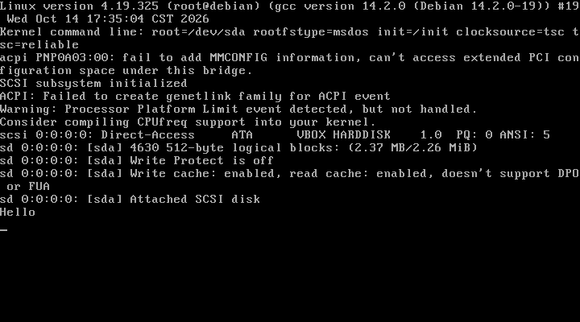

# Linux Purification Plan

Linux hasn't been KISS for long time. To ease my OCD, it must be purified, under code-level. I've been researching for long, Best way is to start from elf execution mechanism: 1. Add "ld=" kernel parameter, all loading elf works will be left to ld, bypass DT_INTERP. 2. Modify musl ld, to support both static and dynamic linked elf, .so searching rule will be limited to application location and PATH, remove everything else. I like MS-DOS's simple, intuitive and flexible, pure autoexec.bat, pure PATH environment variable, whole levels are  straight forward, no twists or turns. I want Linux also like this, get rid of fucking systemd, sysv, openrc ... , init is as simple as autoexec.bat, everyone can edit it. I also want as simple GUI, since kernel already provided drm/kms, /dev/input and alsa, get fuck off everything else, maybe tinywl is enough, just like Windows 3.x, plus some essential utilities, such as text editor, terminal emulator, calculator, web browser, multimedia player, that's enough, fuck those flashy but useless things.

Project location is <https://github.com/shajunxing/linux-purification-plan> , continuously evolving.

To be honest, I also dislike Windows since XP. I imagine if it can be added from [Validation OS](https://learn.microsoft.com/en-us/windows-hardware/manufacture/desktop/validation-os-overview) by necessary parts: network, security, direct x, get rid of everything corresponding .net dwm, and add classic shell like Win95, that's enough. But I also realized putting too much effort in is meaningless.

## Direct Boot tools for VirtualBox

So first, I need to set up handy environment. QEMU can directly boot kernel and in-memory filesystem, but I hate QEMU because it’s too messy. My another Debian laptop got completely messed up by QEMU, when I uninstalled it, it didn’t disable kernel modules, which made VirtualBox unable to start. Many people in open-source world are unable to do things right, they only love pretentious.

I also hate initrd/initramdisk. Why can’t those amateurs just walk straight? Why do they insist on taking detours, adding extra steps to show off their so-called technical skills? Linux kernel is already bloated enough, does it really matter how much space few filesystem drivers take?

I like VirtualBox's small, stable, cross-platform. I want it to work like QEMU’s direct boot. After many research, feasible approach is: find simplest FAT16 filesystem which kernel can recognize (there’s also ROMFS, but not sure if it can write to hard disk partition). Then write kernel, init and bootcode into .raw format file, and convert to .vdi using VirtualBox tools.

There’s no existing FAT16 creation tool, so I wrote my own `raw.c`, super floppy format, only one partition, no master boot record. Since FAT has bootstrap section, it can boot properly. Write files sequentially into root directory on consecutive sectors, filenames strictly follow 8.3 convention, and are converted to uppercase. First file will be treated as kernel, loaded by bootcode. Bootcode `boot.s` is modified from famous <https://sebastian-plotz.blogspot.com/> (included in kernel docs), compiled with nasm, then converted to text format with `bin2c.c` to include in `raw.c`. Steps above are in batch file `make.bat`.

Next, compile kernel. On my Debian VM, first `make allnoconfig` or `make tinyconfig` to get minimal setup, then add support for tty/vt, msdos vfat, elf, etc. (I provided `.config` from 4.19.325 kernel. Why this version? Because I hate C++; I asked ChatGPT check latest GCC version that can be bootstrapped with pure C, which is 4.7.4, so I chose corresponding kernel version for later researches.) Then write simple `init.c` and compile it statically with `gcc -static -o init init.c`.

With all materials ready, run `raw -o output.raw bzImage init` to generate image file, then run `VBoxManage convertfromraw output.raw fat16.vdi --format VDI` to convert, add it to 64-bit Linux VM, choose SATA/AHCI controller, boot, success. Steps above can be automated by `start.js` (based on <https://github.com/shajunxing/sjx-script>).

